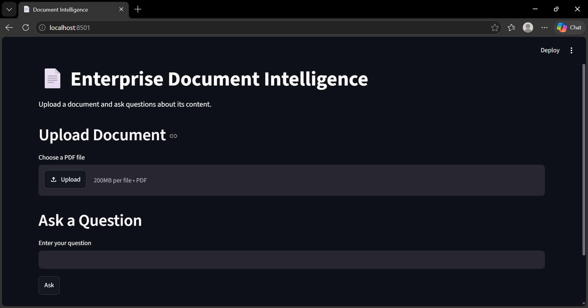
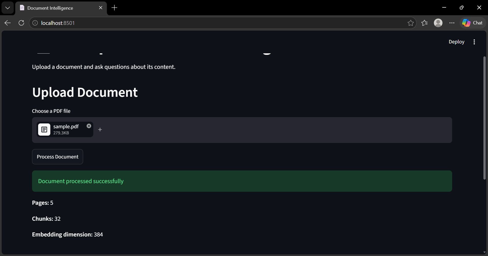
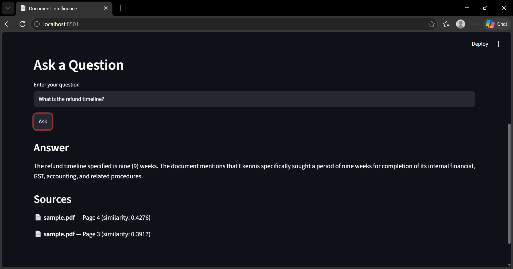
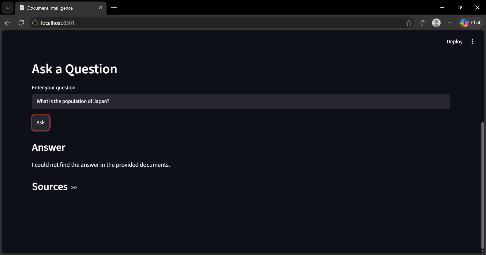
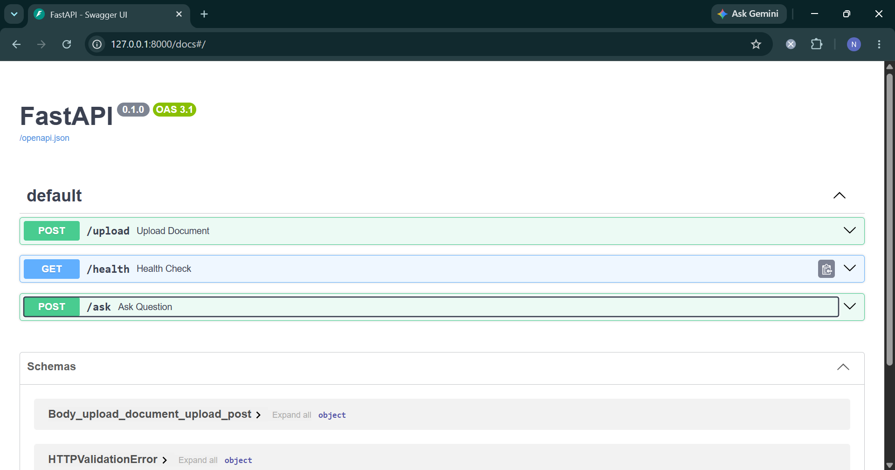

# Enterprise Document Intelligence Platform

An end-to-end document intelligence and Retrieval-Augmented Generation (RAG) system that allows users to upload PDF documents and ask natural-language questions about their content.

The system extracts document text, creates metadata-aware chunks, generates embeddings, stores them in PostgreSQL with pgvector, retrieves relevant information using hybrid search, and generates grounded answers using a local LLM through Ollama.

## Architecture

```text
PDF Document
     ↓
Text Extraction
     ↓
Metadata-Aware Chunking
     ↓
Sentence Transformer Embeddings
     ↓
PostgreSQL + pgvector
     ↓
Hybrid Retrieval
(Semantic + Keyword Search)
     ↓
Relevant Chunks
     ↓
Ollama / Qwen 2.5 3B
     ↓
Grounded Answer + Source Pages
     ↓
FastAPI
     ↓
Streamlit UI
```
## Demo

### Streamlit Interface

The application provides a simple interface for uploading PDF documents and asking questions about their content.



### Document Processing

After uploading a document, the system extracts the pages, creates chunks, and generates embeddings.



### RAG Question Answering

The system generates an answer using retrieved document context and displays the source document and page information.



### Hallucination Guardrail

When the requested information cannot be found in the documents, the system avoids generating an unsupported answer.



### FastAPI

The backend exposes REST API endpoints for document processing and question answering.




## Features

- PDF document upload
- Page-aware text extraction
- Metadata-aware chunking
- Local sentence-transformer embeddings
- PostgreSQL with pgvector
- Hybrid semantic + keyword retrieval
- Local LLM inference using Ollama
- Source and page citations
- Retrieval relevance threshold to reduce hallucinations
- Multiple document support
- FastAPI REST API
- Streamlit user interface
- Basic RAG evaluation
- Application logging
- Error handling
- Docker-ready project structure

## Technology Stack

- Python
- FastAPI
- Streamlit
- PostgreSQL
- pgvector
- Sentence Transformers
- PyMuPDF
- Ollama
- Qwen 2.5 3B
- Docker

## Project Structure

```text
enterprise-document-intelligence/
│
├── documents/
│   └── sample.pdf
│
├── src/
│   ├── chunker.py
│   ├── database.py
│   ├── document_loader.py
│   ├── embedding.py
│   └── generator.py
│
├── api.py
├── streamlit_app.py
├── evaluation.py
├── requirements.txt
├── .env
├── .gitignore
└── README.md
```

## How It Works

### 1. Document Processing

A PDF is uploaded through the Streamlit interface.

PyMuPDF extracts text while preserving page information.

The extracted text is divided into overlapping chunks so that relevant information can be retrieved efficiently.

### 2. Embeddings

Each chunk is converted into a numerical vector using:

```text
all-MiniLM-L6-v2
```

The model generates 384-dimensional embeddings.

### 3. Vector Storage

Document chunks, page numbers, and embeddings are stored in PostgreSQL using the pgvector extension.

### 4. Hybrid Retrieval

When a user asks a question, the question is converted into an embedding.

The system combines:

- Semantic similarity using vector search
- Keyword relevance using PostgreSQL full-text search

The final retrieval score uses a weighted combination of both methods.

### 5. RAG Generation

The most relevant chunks are passed to the local Qwen 2.5 3B model through Ollama.

The model is instructed to answer only using the retrieved document context.

If no sufficiently relevant information is found, the system returns:

```text
I could not find the answer in the provided documents.
```

### 6. API and UI

FastAPI exposes the document upload and question-answering endpoints.

Streamlit provides a simple interface for uploading documents and asking questions.

## API Endpoints

### Health Check

```text
GET /health
```

Returns the API health status.

### Upload Document

```text
POST /upload
```

Uploads and processes a PDF document.

### Ask Question

```text
POST /ask
```

Example request:

```json
{
  "question": "What is the refund deadline?"
}
```

The response contains the generated answer and source document pages.

## RAG Evaluation

The project includes an evaluation script:

```bash
python evaluation.py
```

The evaluation checks whether generated answers contain expected information for predefined questions.

Current evaluation covers questions related to:

- Refund timeline
- Refund deadline
- Procedures mentioned in the refund process

The current test set achieved:

```text
3/3 tests passed
```

## Local Setup

### 1. Clone the repository

```bash
git clone <your-github-repository-url>
cd enterprise-document-intelligence
```

### 2. Create a virtual environment

```bash
python -m venv venv
```

Activate it on Windows:

```powershell
venv\Scripts\Activate.ps1
```

### 3. Install dependencies

```bash
pip install -r requirements.txt
```

### 4. Configure PostgreSQL

Create a PostgreSQL database named:

```text
document_intelligence
```

Install and enable the pgvector extension:

```sql
CREATE EXTENSION vector;
```

Create the required table:

```sql
CREATE TABLE document_chunks (
    id BIGSERIAL PRIMARY KEY,
    document_name TEXT NOT NULL,
    page_number INTEGER NOT NULL,
    chunk_text TEXT NOT NULL,
    embedding VECTOR(384)
);
```

### 5. Configure environment variables

Create a `.env` file:

```env
DB_HOST=localhost
DB_NAME=document_intelligence
DB_USER=postgres
DB_PASSWORD=your_password
DB_PORT=5432
```

Never commit `.env` to GitHub.

### 6. Install and run Ollama

Install Ollama and download the local model:

```bash
ollama pull qwen2.5:3b
```

Make sure the Ollama service is running before asking questions.

### 7. Start FastAPI

```bash
python -m uvicorn api:app --reload
```

API documentation:

```text
http://127.0.0.1:8000/docs
```

### 8. Start Streamlit

In another terminal:

```bash
streamlit run streamlit_app.py
```

The Streamlit interface can then be used to upload PDFs and ask questions.

## Design Considerations

The project is designed to run locally using open-source components.

This avoids dependency on paid cloud APIs and keeps the system suitable for experimentation, learning, and portfolio demonstration.

The retrieval relevance threshold and context-only generation prompt are used as simple guardrails against unsupported answers.

## Future Improvements

Potential extensions include:

- Cross-encoder reranking
- More advanced RAG evaluation metrics
- OCR support for scanned PDFs
- Conversation history
- Document-level filtering
- Docker Compose for PostgreSQL and application services
- Cloud deployment
- Authentication and role-based access control

## Author

Nomeshwar V